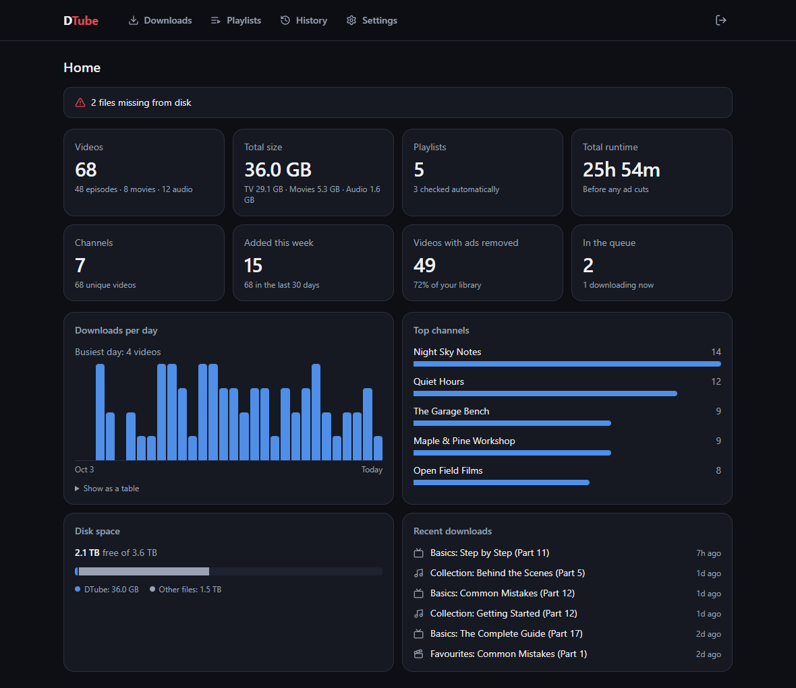
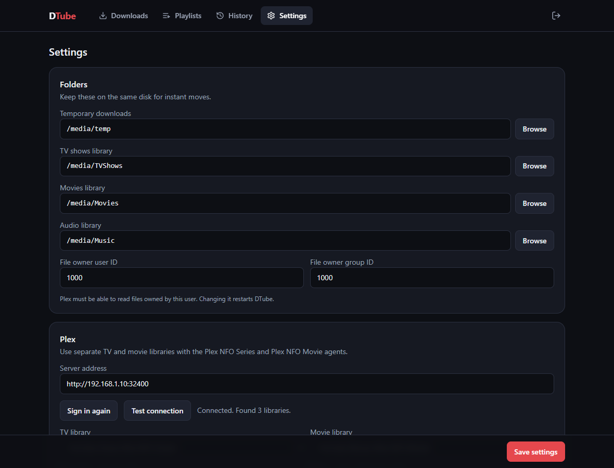
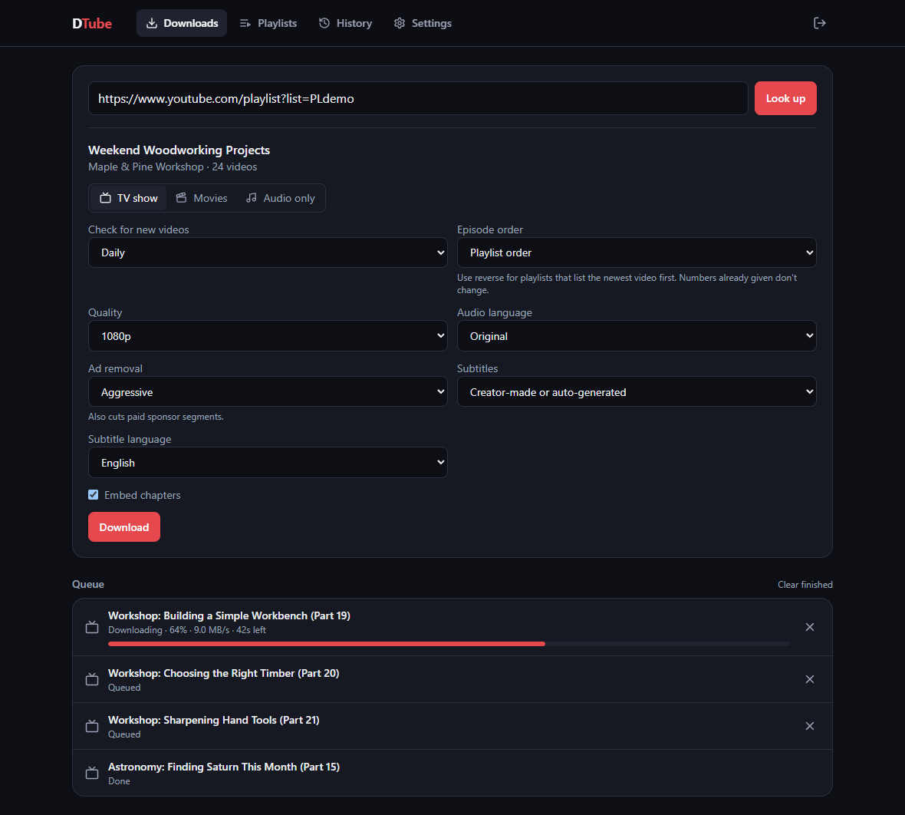
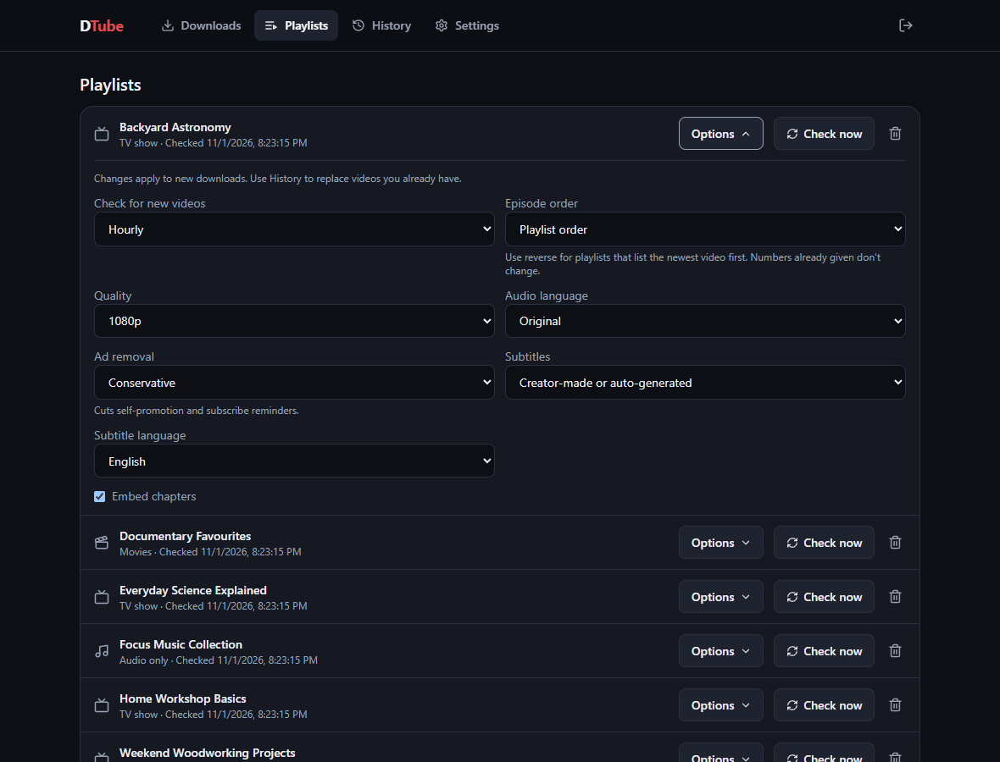
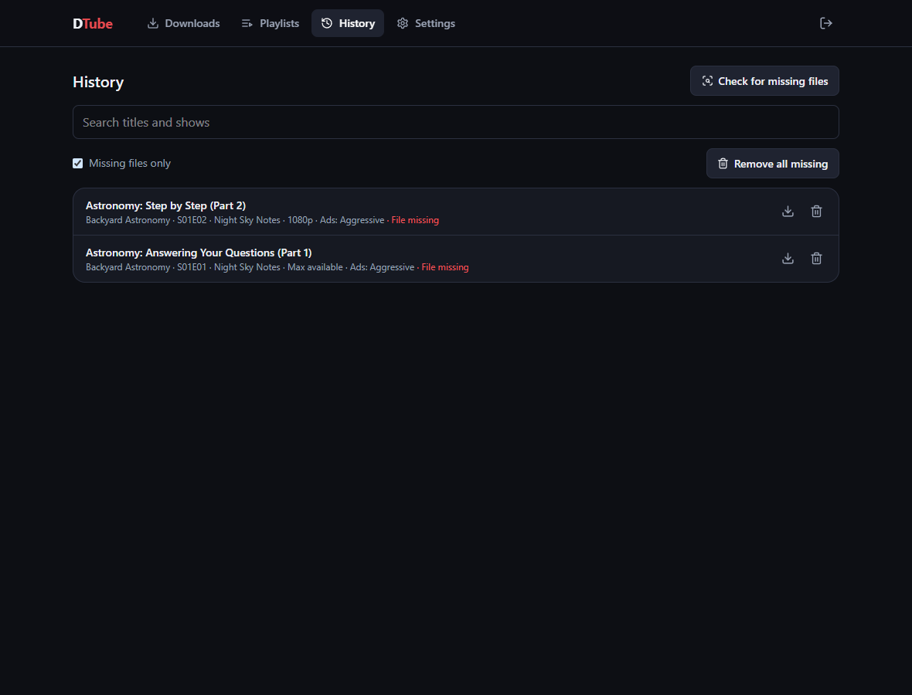

# DTube

Self-hosted YouTube downloader for Plex, built on [yt-dlp](https://github.com/yt-dlp/yt-dlp).

Paste a playlist or video URL, pick how you want it, and DTube files it into Plex as a TV show, movies or audio. Everything is set up in the web UI, and the compose file needs one line changed.



## Features

- **TV, movie or audio:** playlists can be any of the three. Single videos can be a movie or audio.
- **Download history:** a video is never downloaded twice unless you ask.
- **New video checks:** each playlist can check immediately (every 5 minutes), hourly, daily or not at all.
- **Quality:** max available, 1080p, 720p, 480p or 360p.
- **Ad removal:** cuts creator-inserted ads using [SponsorBlock](https://sponsor.ajay.app/).
- **Subtitles:** creator-made or auto-generated, in a language you choose.
- **Audio language:** keep the original, or prefer a language on videos with dubbed tracks.
- **Chapters:** YouTube's chapters are embedded in the video file.
- **Plex:** sign in once, and libraries refresh after downloads finish.
- **Homepage:** library size, runtime, activity, top channels and disk space.
- **Single login:** one admin account. Cookies are optional.

## Install

DTube runs in Docker on 64-bit x86 machines. The image is published to `ghcr.io/untidycreativemind/dtube`, so there's nothing to build and no login needed.

### 1. Create your folders

Make one parent folder with a subfolder for each thing you'll use. Keeping them together makes moves instant.

```sh
mkdir -p /mnt/storage/youtube/{temp,TVShows,Movies,Music}
chown -R 1000:1000 /mnt/storage/youtube
```

`1000:1000` matches DTube's default file owner. Create the folders first, because Docker creates a missing folder as root and DTube then can't write to it.

### 2. Start DTube

Save [`docker-compose.yml`](docker-compose.yml) in a new folder, or paste it into a Portainer stack:

```sh
curl -O https://raw.githubusercontent.com/UntidyCreativeMind/DTube/main/docker-compose.yml
```

Change the one marked line to the **full path** of your parent folder:

```yaml
services:
  dtube:
    image: ghcr.io/untidycreativemind/dtube:latest
    container_name: dtube
    restart: unless-stopped
    ports:
      - "3434:3434"
    volumes:
      - dtube-config:/config
      - /mnt/storage/youtube:/media # the only line you edit

volumes:
  dtube-config:
```

Then start it:

```sh
docker compose up -d
```

### 3. Create your login

Open `http://<host>:3434` and create your admin account straight away. Until you do, anyone who can reach the port can create it, so do this before adding a reverse proxy.

### 4. Choose your folders

In **Settings → Folders**, pick each folder. Your parent folder appears as `/media`, so these are `/media/temp`, `/media/TVShows`, `/media/Movies` and `/media/Music`. You only need the ones you'll use.

If DTube can't write to a folder, set **File owner** to a user that can. On an NTFS or similar drive, `chown` has no effect, so use the numbers shown by `ls -ln`. Changing the owner restarts DTube.

### 5. Set up Plex

Create new Plex libraries instead of reusing your existing ones. Otherwise Plex may match playlists to unrelated real shows, and the agent setting would change your other media.

| Library type | Folder | Agent (under **Advanced**) |
|---|---|---|
| TV Shows | `.../youtube/TVShows` | **Plex NFO Series** |
| Movies | `.../youtube/Movies` | **Plex NFO Movie** |
| Music | `.../youtube/Music` | Plex's music agent, preferring local metadata |

Point each library at its subfolder, using the path Plex sees. If an NFO agent isn't listed, refresh the browser. They need Plex Media Server 1.43.1 or newer, and libraries using them don't work with Plex's watch state and ratings sync.

To show channel names as season names, turn on **Use Season Titles** in the TV library's Advanced settings, then refresh the library's metadata. A season Plex already created may need its show refreshed or rematched.

### 6. Connect Plex

In **Settings → Plex**:

1. Enter your server address, such as `http://192.168.1.10:32400`.
2. Click **Sign in with Plex** and approve it in the new tab.
3. Pick your libraries and click **Save settings**.

If Plex sees your folders under a different path than DTube, for example because it runs in its own container, fill in the two path mapping fields.



## Using DTube

### Add a playlist or video

On **Downloads**, paste a URL and click **Look up**. Choose your options, then click **Download**. Settings holds the defaults.



| Option | Choices | Notes |
|---|---|---|
| **Mode** | TV show, Movies, Audio only | Single videos can be a movie or audio |
| **Check for new videos** | Off, Immediate, Hourly, Daily | Immediate means every 5 minutes, because YouTube can't notify DTube. Use it sparingly, or YouTube may limit requests |
| **Episode order** | Playlist order, Reverse playlist order | Use reverse for playlists that list the newest video first. Set this before downloading, because numbers are permanent |
| **Quality** | Max available, 1080p, 720p, 480p, 360p | 1080p and below prefer H.264 MP4 for direct play. Max saves larger MKV files that some Plex clients transcode |
| **Audio language** | Original, or one of 12 languages | Falls back to the original if the language isn't offered |
| **Ad removal** | Off, Conservative, Aggressive | See below |
| **Subtitles** | Off, Creator-made only, Creator-made or auto-generated | Saved beside the video as `Title.en.srt`. If YouTube refuses, the video is still saved with a note in the queue |
| **Embed chapters** | On or off | On by default |

### How files are organised

In TV mode, the playlist is the show, each channel is a season, and each video is an episode. Episode numbers are permanent, so reordering a playlist or deleting a video never renames anything.

```text
TVShows/My Playlist/
├── tvshow.nfo
├── poster.jpg
└── Season 01/
    ├── My Playlist - S01E01 - Video Title.mp4
    ├── My Playlist - S01E01 - Video Title.nfo
    ├── My Playlist - S01E01 - Video Title.jpg
    └── My Playlist - S01E01 - Video Title.en.srt

Movies/Video Title/
├── Video Title.mp4
├── Video Title.jpg
└── movie.nfo

Music/My Playlist/
├── cover.jpg
└── 01 - Track Title.m4a
```

Audio is tagged with the playlist as the album and the channel as the artist. Single videos go in an album called `Singles`.

### Ad removal

YouTube's own ad breaks are never in a download. These levels cut segments creators build into their videos:

| Level | What gets cut |
|---|---|
| **Off** | Nothing |
| **Conservative** | Self-promotion and subscribe reminders |
| **Aggressive** | All of that, plus paid sponsor segments |

Segments come from the community-run SponsorBlock database, so very new videos may not have any marked yet, and cuts can occasionally be wrong. If SponsorBlock can't be reached, DTube retries rather than filing an uncut video.

### Manage playlists

**Playlists** lists everything you're tracking. **Options** changes a playlist's settings for new downloads, and **Check now** looks for new videos straight away.



The trash icon stops tracking a playlist and removes its waiting downloads. **Neither choice deletes files.**

| Choice | History and numbering | If you add the playlist again |
|---|---|---|
| **Keep history** | Kept | Nothing re-downloads, and numbering carries on |
| **Forget everything** | Cleared | Everything downloads again from episode 1 |

Delete the files yourself before tracking a forgotten playlist again, or you may end up with duplicates.

### History and missing files

**History** lists everything downloaded and checks for missing files when it opens. The download icon re-downloads a video, with different options if you like, and keeps its episode number.

A video whose file is gone can also be removed from DTube with the trash icon, or all at once with **Missing files only** and **Remove all missing**. Scheduled checks won't download a removed video again, but **Check now** will, and it comes back as a new episode.



## Updating

```sh
docker compose pull
docker compose up -d
```

In Portainer, redeploy the stack with the re-pull image option on. Your settings and history are kept in the `dtube-config` volume, and yt-dlp updates itself daily, or from **Settings** with **Update now**.

Back up that volume if you can. Removing it, including with `docker compose down -v`, erases your login, settings, history and episode numbering. Your media files aren't in it.

## Reverse proxy

DTube serves plain HTTP on port 3434, so HTTPS comes from your proxy. In Nginx Proxy Manager, turn on **Websockets Support** for the proxy host so live download progress works.

## Cookies

DTube works without cookies. Uploading a `cookies.txt` in Settings can help with age-restricted videos or rate limiting. Use a throwaway Google account, because logged-in downloading can get an account banned.

## Troubleshooting

| Problem | What to do |
|---|---|
| `refers to undefined volume` when deploying | The path in compose is missing its leading `/` |
| `DTube can't write to...` in Settings | Set **File owner** to a user that owns the folder |
| Downloads won't start | Check the folders are set, and that free space is above **Keep free** |
| Plex shows unrelated titles or artwork | Make sure the library uses an NFO agent, not the default agent |
| Seasons show as "Season 01" | Turn on **Use Season Titles**, then refresh the show's metadata |
| Subtitles missing, with a note in the queue | YouTube limited the request. Re-download from History later |
| `YouTube is limiting requests` | Wait a while, check less often, or add cookies |
| Anything else | The queue shows each video's error, and `docker logs dtube` has the details |

## Development

The backend is Python and FastAPI, in `backend/`. The frontend is React, TypeScript and Tailwind, in `frontend/`. See [docs/DESIGN.md](docs/DESIGN.md) for how it fits together.

```sh
pip install -r backend/requirements.txt pytest
PYTHONPATH=backend pytest backend/tests
```

Every push to `main` runs the tests, builds the image, checks that it starts, and publishes it only if those steps pass.

DTube isn't affiliated with YouTube or Plex. You're responsible for how you use it.
